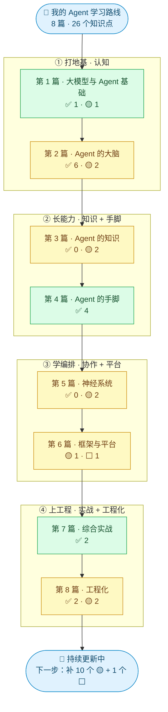
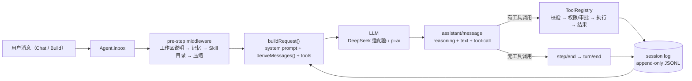
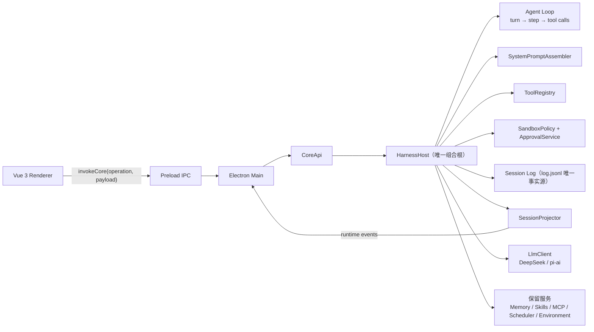
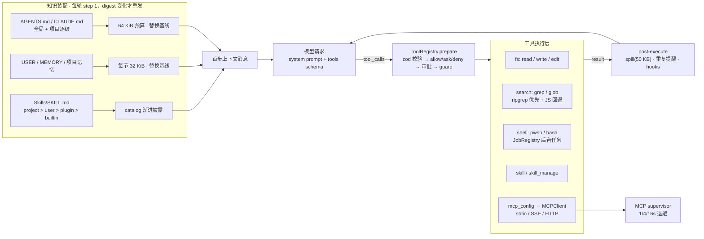
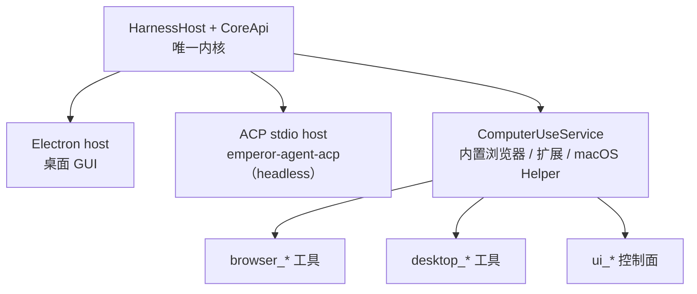
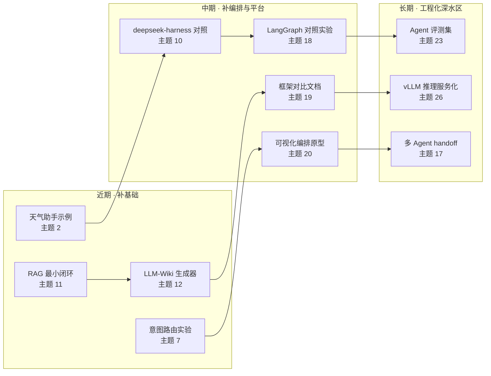

<div align="center">


# 小金 Agent · XiaoJin Agent

**中文桌面智能体工作台 · 我的 Agent 工程学习路线**


**8 篇 · 26 个知识点 · 一张从「什么是 Agent」到「工业级 Harness」的学习地图**

**15 已实现 · 10 部分实现 · 1 待补 —— 每个判定都对照真实代码取证**

</div>

---

> **关于本仓库**：本仓库记录我在这个项目上的中文桌面端改造、文档与发布工程实践，以及这份 **Agent 学习路线 + 26 主题代码覆盖审计**。完整说明见文末 [项目来源、版权与致谢](#-项目来源版权与致谢)。

## 📌 一分钟了解

| 维度 | 内容 |
| --- | --- |
| **项目是什么** | 一个本地运行的中文桌面 Agent 工作台：普通对话、项目工作、先规划再执行、持续目标，支持工具调用、MCP、Skills、记忆与执行轨迹 |
| **这份 README 是什么** | 我的 **Agent 工程学习路线**：把 8 篇 26 个知识点逐一对照本仓库代码，判断「有没有、在哪、学到什么、还缺什么」 |
| **覆盖结论** | ✅ 15 已实现 · 🟡 10 部分实现 · ⬜ 1 未覆盖（共 26 个主题） |
| **代码规模** | 1,603 个文件 · 1,052 个 TypeScript 文件 · 279 个 Vue 组件 · 约 29 万行源码 · 400+ 测试文件 · 32 篇项目文档 |
| **三个运行入口** | Electron 桌面端 · headless ACP 命令行入口（`emperor-agent-acp`）· 浏览器 / 桌面 GUI 自动化 |
| **审计方式** | 4 个并行审计员做静态代码审计，每个判定落到文件路径 + 符号名；区分「文档声称」与「代码可证」 |

## 🗺️ 学习路线总览



### 八篇进度

| 篇 | 主题数 | ✅ 已实现 | 🟡 部分实现 | ⬜ 未覆盖 | 进度 |
| --- | :---: | :---: | :---: | :---: | --- |
| 第 1 篇 · 大模型与 Agent 基础 | 2 | 1 | 1 | 0 | `██████████░░░░░░░░░░` 50% |
| 第 2 篇 · Agent 的大脑 | 8 | 6 | 2 | 0 | `███████████████░░░░░` 75% |
| 第 3 篇 · Agent 的知识 | 2 | 0 | 2 | 0 | `██████░░░░░░░░░░░░░░` 30% |
| 第 4 篇 · Agent 的手脚 | 4 | 4 | 0 | 0 | `████████████████████` 100% |
| 第 5 篇 · 神经系统 | 2 | 0 | 2 | 0 | `██████░░░░░░░░░░░░░░` 30% |
| 第 6 篇 · 框架与平台 | 2 | 0 | 1 | 1 | `███░░░░░░░░░░░░░░░░░` 18% |
| 第 7 篇 · 综合实战 | 2 | 2 | 0 | 0 | `████████████████████` 100% |
| 第 8 篇 · 工程化 | 4 | 2 | 2 | 0 | `███████████░░░░░░░░░` 55% |
| **合计** | **26** | **15** | **10** | **1** | `███████████░░░░░░░░░` **58%** |

> 进度按「✅ 记 1 分、🟡 记 0.5 分」折算。百分比是学习路线的粗略刻度，不是项目质量评分。

## 🧭 26 个主题覆盖矩阵

**判定口径**：✅ = 有真实代码路径与运行时接线，能指到文件 + 符号；🟡 = 有相关机制，但不构成该主题的完整形态；📚 = 只有文档/设计；⬜ = 项目里没有对应内容。
**原则**：界面里有按钮 ≠ 能力已实现，README 里有描述 ≠ 代码可证。

| # | 主题 | 判定 | 在这个项目里对应什么（证据） | 我的一句话理解 |
| :---: | --- | :---: | --- | --- |
| 1 | 什么是 AI Agent | ✅ | [`harness/agent/agent.ts`](packages/core/src/harness/agent/agent.ts)（ReAct 循环驱动、turn/step）、[`tools/registry.ts`](packages/core/src/harness/tools/registry.ts) | Agent = 模型 + 工具 + 循环 + 状态四件套 |
| 2 | 第一个 Agent：天气查询助手 | 🟡 | 没有天气示例；最小调用见 [`host.test.ts`](packages/core/src/harness/host/host.test.ts)，用 `defineTool()` 可自建 | 零件齐全，但缺一个「30 行入门示例」 |
| 3 | 提示词工程 | ✅ | [`prompt/assembler.ts`](packages/core/src/harness/prompt/assembler.ts)（有序 section + 严格变量插值）、[`persona.md`](templates/agent/persona.md) | 系统提示词是「注册表 + 模板」，不是字符串拼贴 |
| 4 | 上下文工程 | ✅ | [`agent.ts`](packages/core/src/harness/agent/agent.ts) 的 `buildRequest()`、[`compaction/engine.ts`](packages/core/src/harness/compaction/engine.ts)（0.8 阈值 / 保留 0.16 / 8 章节摘要） | 两条底层原则：信源唯一 + 预算驱动 |
| 5 | ReAct | ✅ | reasoning 块 + tool-call + tool/result 回填循环（[`tool-calls.ts`](packages/core/src/harness/agent/tool-calls.ts)） | Thought / Action / Observation 的现代 tool-calling 形态 |
| 6 | Agent 的记忆系统 | ✅ | [`harness/memory/memory.ts`](packages/core/src/harness/memory/memory.ts)、[`memory/store.ts`](packages/core/src/memory/store.ts)（USER / MEMORY.local.md、按日情景、版本快照） | 记忆是应用状态，不是工作区文件；变化才注入 |
| 7 | 意图识别与决策中枢 | 🟡 | Chat / Build / Plan / Goal 显式模式机 + [`commands/parser.ts`](packages/core/src/commands/parser.ts)；无 LLM 意图分类器 | 工业 Agent 常用「确定性路由」而不是「让模型猜意图」 |
| 8 | Agent 运行时：Loop 引擎与沙箱 | ✅ | [`sandbox/policy.ts`](packages/core/src/harness/sandbox/policy.ts) 三模式 + Seatbelt / bubblewrap 后端 + [`approval/presets.ts`](packages/core/src/harness/approval/presets.ts) | 沙箱 × 审批是两个独立旋钮，审批不等于沙箱 |
| 9 | Harness 工程 | ✅ | [`host.ts`](packages/core/src/harness/host/host.ts) 的 `HarnessHost.compose()`、四类 middleware 扩展点、session log 事实源、projector 投影 | 组合根 + 扩展点 + 事实源 + 投影 |
| 10 | 工业级 Harness 解剖：deepseek-harness-java | 🟡 | [`agent-runtime.md`](docs/architecture/agent-runtime.md) 提及 dsh 语义，代码注释有 `ported from dsh-*`；没有 Java 对照材料 | TS 侧同构实现能解剖，Java 对照要补 |
| 11 | RAG：检索增强生成 | 🟡 | grep / glob / read 词法检索 + 整文件注入；无 embedding / 向量库（旧 hybridMemory 已退役） | RAG 的关键是「索引 → 分块 → 召回」闭环，不是有个搜索框 |
| 12 | LLM-Wiki：项目知识文件 | 🟡 | [`agent-instructions.ts`](packages/core/src/harness/prompt/agent-instructions.ts)（AGENTS.md / CLAUDE.md 分级发现、64 KiB 预算、digest 替换）；项目知识索引仅有设置页摘要 | 知识文件四要素：发现顺序、优先级、字节预算、变化才重发 |
| 13 | Function Calling 与工具设计 | ✅ | [`tools/definition.ts`](packages/core/src/harness/tools/definition.ts) 的 `defineTool()`（zod 单一 schema）+ registry 全管线 | schema 单一事实源 + 一切失败结果化 |
| 14 | MCP：工具的标准化接口 | ✅ | [`mcp/`](packages/core/src/mcp)（stdio / SSE / HTTP、supervisor 1/4/16s 退避、动态 reload、`mcp_<server>_<tool>`） | MCP = 配置解析 + 传输抽象 + 生命周期监管 |
| 15 | Skills：工具的组合与复用 | ✅ | [`skills/`](packages/core/src/skills)（SKILL.md 多来源优先级、catalog 渐进披露、`skill_manage` 审批） | 渐进披露省上下文，来源决定可写性 |
| 16 | CLI 能力：Agent 操作本地工具 | ✅ | [`shell/tool.ts`](packages/core/src/harness/tools/builtin/shell/tool.ts)（pwsh / bash、超时、进程树终止、后台 Job、沙箱提权） | 真正难的是执行边界：超时 / 取消 / 输出限流 / 权限 |
| 17 | 多 Agent 系统架构 | 🟡 | [`subagent/manager.ts`](packages/core/src/harness/subagent/manager.ts)（spawn / fork、深度 3、report + send_message）、[`workflow/engine.ts`](packages/core/src/harness/workflow/engine.ts) 扇出；Agent Teams 已移除 | 监督者式子代理是最常见的多 Agent 形态 |
| 18 | LangGraph 与状态机 | 🟡 | 无 LangGraph；自研 Goal 4 态状态机、轮次 `queued → claimed → admitted`、Plan 审批门、命令式 workflow 脚本 | 状态机 + 事件溯源可以替代图框架，但缺声明式图与 checkpoint |
| 19 | 主流 Agent 框架对比 | 🟡 | Pi AI + MCP + ACP + DeepSeek 适配器真实存在；没有框架对比/选型文档 | 要分清「协议适配层」和「编排框架」 |
| 20 | Dify、Coze 与可视化编排 | ⬜ | 无画布 / 节点编辑器；只有只读的工作流运行树 [`WorkflowRunPanel.vue`](desktop/src/renderer/src/components/conversation/nodes/WorkflowRunPanel.vue) | 本项目是「编排即代码」，不是「编排即产品」 |
| 21 | CLI Agent：命令行智能助手 | ✅ | [`acp/`](packages/core/src/acp)（`emperor-agent-acp`、stdio JSON-RPC、esbuild 单文件打包、e2e 测试） | 同一内核多入口：Electron / ACP / GUI 共用一套 CoreApi |
| 22 | GUI Agent：浏览器自动化 | ✅ | [`computer-use/tools`](packages/core/src/harness/computer-use/tools)（`browser_*` / `desktop_*` / `ui_*`）、CDP 内置浏览器、MV3 扩展 + Native Host、macOS Helper | 语义观察（ref）优先于坐标点击，每次动作前校验 revision |
| 23 | Agent 评估与可观测性 | 🟡 | 轨迹视图 + 请求头快照 diff + `TokenTracker` + 成本上限 + 诊断页 + 400+ 测试；没有 Agent 评测集/评分器 | 可观测性 ≠ 评估；评测要任务集 + rubric + 成功率 |
| 24 | Agent 安全与防护 | ✅ | 权限预设、逐次审批、OS 沙箱、外部内容信封（`untrusted_external / data_only`）、GUI gate、mutation-guard | 两条底线：fail closed、外部输入一律当数据 |
| 25 | Agent 部署与运维 | ✅ | electron-builder 三平台、签名/公证/SBOM/attestation、Preview/Stable runbook、打包 smoke、诊断与恢复页 | 供应链式发布：打包冒烟 + receipt + 聚合合同 |
| 26 | 推理框架与模型服务化 | 🟡 | 27 个 Provider 预设（含 Ollama / LM Studio / vLLM / OVMS 客户端接入）；没有推理框架与服务化部署 | 项目是推理服务的「消费方」，不是「供给侧」 |

> 想直接跳到某一篇的机制讲解：可看下方 [分篇笔记](#-分篇笔记我学到了什么)，或按需读 [`docs/architecture/`](docs/architecture)。

## 📖 分篇笔记：我学到了什么

### 第 1 篇 · 大模型与 Agent 基础（✅ 1 · 🟡 1）

**核心认知**：Agent 不是某个 prompt，而是「模型 + 工具 + 循环 + 状态」四件套。在本仓库里，这四件套分别落在 `Agent`（每个 session 一个循环驱动）、`ToolRegistry`（工具注册与执行管线）、`turn/step` 循环、`session log`（唯一事实源）上。

- 自主循环的入口是 [`agent.ts`](packages/core/src/harness/agent/agent.ts)：模型返回 `tool-call` 就执行并回填结果继续请求，没有 `tool-call` 则本轮结束；内核**故意不设最大步数**，把「继续还是结束」交给模型。
- 最小可跑的 Agent 调用在 [`host.test.ts`](packages/core/src/harness/host/host.test.ts)：`HarnessHost.create()` → `host.submit(...)` → 断言事件流。要补「天气查询助手」，只差一个 `defineTool({ name: 'get_weather', ... })` 的 30 行示例——这是更新路线里的第 1 项。
- **缺口**：仓库没有天气助手式教学示例，也没有 `examples/` 目录；入门文档是「怎么用产品」，不是「怎么写第一个 Agent」。

### 第 2 篇 · Agent 的大脑（✅ 6 · 🟡 2）

这是整条路线的核心，也是本仓库最强的部分。8 个主题里有 6 个能直接指到工业级实现：

- **提示词工程（3）**：系统提示词是「有序 section 注册表 + 严格变量插值 + 动态上下文快照」。[`assembler.ts`](packages/core/src/harness/prompt/assembler.ts) 对未知变量直接抛错，避免拼装错误被静默发给模型；[`agent-instructions.ts`](packages/core/src/harness/prompt/agent-instructions.ts) 从全局 `AGENTS.md` 到项目根逐级发现 `AGENTS.md` / `CLAUDE.md`，全局预算 64 KiB。
- **上下文工程（4）**：模型请求只从 append-only session log 派生（「模型可见 ⟺ 已记录」），可重放、可崩溃修复；token 到窗口 80% 先 prune 旧工具结果，再走固定 8 章节摘要，保留约 16% 尾部。**压缩只改「模型可见表面」，不改事实源**，这是我学到的最重要的一条设计。
- **ReAct（5）**：不是论文里的 Thought/Action/Observation 文本协议，而是现代 tool-calling：一条 assistant 消息里同时产出 reasoning 块、text 块、tool-call 块，工具结果作为观察回填。关键工程点是「每个调用必有结果」——中止时未开始的调用会被合成 `ABORTED_BEFORE_DISPATCH`。
- **记忆系统（6）**：四层记忆——会话 log（短期）、按日情景记忆（中期）、`MEMORY.local.md` + `USER.local.md`（跨会话）、Build 项目私有记忆。写入走 `memory_edit` 工具（应用状态，不走文件沙箱），每次写入留版本快照；子代理不能写长期记忆。
- **意图识别与决策中枢（7，🟡）**：项目没有「让大模型判断用户想干什么」的分类器，而是显式模式机（Chat / Build / Plan / Goal）+ 确定性斜杠命令路由。未知命令本地报错、不降级成模型请求。结论：**可预测、可审计优先于「聪明」**。
- **运行时 Loop 与沙箱（8）**：`Agent` 是三态状态机（idle / maintenance / running）+ AbortSignal；沙箱范围（read-only / workspace-write / danger-full-access）与审批策略是两个独立旋钮，打包成 3 个权限预设；提权必须「严格更宽」且只生效一次。**审批不是沙箱**，Windows 没有受限 Shell 沙箱后端时 fail closed。
- **Harness 工程（9）**：`HarnessHost.compose()` 是唯一组合根，工具、prompt section、middleware、Plan / Goal / 子代理 / workflow 都在这里装配；Session Log 是唯一事实源，界面 runtime event 是同一次 fold 的投影；崩溃恢复只合成收尾事件，不重放工具副作用。
- **工业级 Harness 解剖（10，🟡）**：代码注释保留了 `ported from dsh-agent-loop`、`dsh-system-prompt`、`dsh-token-meter` 等线索，可以沿着注释把 TS 实现和 deepseek-harness 的模块对上；但仓库没有 Java 对照材料，想学「harness-java 解剖」需要自己补笔记。

### 第 3 篇 · Agent 的知识（🟡 2）

- **RAG（11，🟡）**：本仓库的「检索」是 **Agentic retrieval**——模型自己调 `grep` / `glob` / `read` 逐层缩小范围，结果超限落盘到 spill 文件；没有 embedding、向量库、分块与按 query 的语义召回。旧内核的混合记忆（关键词 + 向量）已在新内核退役，桌面上还能看到它的死 UI 残留。
- **LLM-Wiki（12，🟡）**：`AGENTS.md` / `CLAUDE.md` / `MEMORY.md` / `USER.md` 这条「知识文件」链路做得很细：发现顺序、字节预算、去重、SHA-256 digest 变化才重新注入。缺的是「把仓库文档生成为 wiki / 索引」的生成器，目前只有设置页的只读摘要。
- **我学到的**：判断一个 Agent 有没有 RAG，不能看有没有搜索按钮，要看「索引 → 分块 → embedding → 召回 → 注入」五处；知识文件注入的关键则是缓存稳定性，而不是每轮偷偷改 system prompt。

### 第 4 篇 · Agent 的手脚（✅ 4）

四个主题全部有完整实现，是我认为最适合拿来讲「工具工程」的部分：

- **Function Calling 与工具设计（13）**：[`defineTool()`](packages/core/src/harness/tools/definition.ts) 用一份 zod schema 同时产出给模型的 JSON Schema 与运行时校验，避免「模型看到的 schema 和实际校验」漂移；一次调用经过「校验 → 权限裁决 → 审批 → guard → 执行 → 后置 → 观察」全管线，任何错误都变成模型可读结果，逃不出循环。
- **MCP（14）**：标准客户端 + stdio / SSE / Streamable HTTP 三种传输 + 连接监管（1/4/16 秒退避、认证失败不重试）+ 配置 diff 动态 reload；远端工具被适配成 `mcp_<server>_<tool>` 注册进同一个 ToolRegistry，所以模型看不到 MCP 与内置工具的区别。
- **Skills（15）**：`SKILL.md` + 多来源优先级（project > user > plugin > builtin）+ catalog 渐进披露（平时只给模型名称和一句话描述，命中后才加载全文）+ `skill_manage` 写操作审批。技能不是可执行插件，而是「按需加载的工作说明 + 资源包」。
- **CLI 能力（16）**：Windows 用 `pwsh -NoProfile -Command`、macOS/Linux 用 `bash -c`；默认 60 秒超时、最大 10 分钟；后台任务用 `JobRegistry`，终止时按进程树 kill；输出按流限量落盘。**CLI 能力的难点从来不是「能执行命令」，而是执行边界。**

### 第 5 篇 · 神经系统（🟡 2）

- **多 Agent 系统架构（17，🟡）**：落地的是「监督者 → 子代理」：`subagent`（全新上下文）与 `subagent_fork`（继承父会话已完成 turn），默认后台运行、深度上限 3，父代理可以 `send_message` 续跑、子代理用 `report` 回传结构化结果；`workflow` 工具把批量委派升级成脚本化扇出（`parallel` / `pipeline`），`ralph` 用 fresh-agent 循环 + 有界结构化 handoff。**Agent Teams 已被移除**，所以对等协作 / 消息总线 / A2A 没有覆盖。
- **LangGraph 与状态机（18，🟡）**：没有引入 LangGraph/LangChain，而是自研了等价机制——Goal 的 4 态显式状态机（active / paused / blocked / complete，带 revision CAS 和迁移表）、轮次的 `queued → claimed → admitted`、Plan 的审批门、workflow 的命令式脚本编排。差距是缺「声明式图 + 通用 checkpointer + 任意节点恢复」。
- **我学到的**：LangGraph 的价值在于把「状态、边、检查点」声明化；本项目说明这些能力也可以用「事件溯源 + 领域状态机」手写出来，但要付出可复用性和可视化的代价。

### 第 6 篇 · 框架与平台（🟡 1 · ⬜ 1）

- **主流 Agent 框架对比（19，🟡）**：项目在「模型接入 + 标准协议」层有多适配（Pi AI、DeepSeek 原生适配器、MCP 客户端、ACP Agent 端、OpenAI / Anthropic 两种线协议），但没有 LangGraph / CrewAI / OpenAI Agents SDK 的适配层，也没有框架选型对比文档。技术栈表是唯一的「框架清单」，且其中 OpenAI / Anthropic SDK 属于依赖声明、实际请求经 pi-ai。
- **Dify、Coze 与可视化编排（20，⬜）**：没有画布、节点编辑器、流程 DSL UI；唯一的工作流界面是只读运行树（run → phase → member）。编排入口只有两个：模型写 JS 脚本的 `workflow` 工具，以及自然语言 / 斜杠命令。**这正好是一个很好的对照样本**：可视化的价值在降低编排门槛，而本项目的取舍是让 Agent 自己写脚本。

### 第 7 篇 · 综合实战（✅ 2）

- **CLI Agent（21）**：真正的非 GUI 入口是 `emperor-agent-acp`——ACP stdio JSON-RPC 服务，复用和 Electron 完全相同的 `CoreApi` / `HarnessHost`，能跑模型、会话、工具、权限、记忆全链路，esbuild 打成单文件并可被 ACP 客户端拉起。它不是交互式 REPL/TUI，交互请求会直接拒绝，属于 operator preview 形态。
- **GUI Agent（22）**：三条驱动线统一到 `ComputerUseService`——CDP 内置浏览器（语义快照 + ref 化操作）、MV3 浏览器扩展 + Native Messaging Host（不申请 `debugger` 权限，通道加密）、macOS 桌面 Helper（Accessibility + ScreenCaptureKit）。动作前校验会话主体、目标租约、generation、观察 revision、授权范围五项，任何一项不匹配就拒绝；另有全局急停。
- **局限**：桌面驱动仅 macOS，Windows/Linux 没有；外部扩展只开放主框架观察与受限 click/fill；截图坐标操作未开放。这些是文档自述的真实边界。

### 第 8 篇 · 工程化（✅ 2 · 🟡 2）

- **评估与可观测性（23，🟡）**：可观测性很完整——会话日志即事实源，轨迹视图按请求展示状态、模型配置、工具调用、token 用量、耗时、prompt 差异；请求头只在变化时追加快照，所以 prompt diff 可回放、可复现；TokenTracker 有热力图 / 趋势 / 排名 / 缓存四个视图，成本上限进入执行策略。但「评估」只剩工程回归测试（单测、golden 投影、Playwright E2E、打包 smoke），没有 Agent 能力评测集、评分器或成功率基准。
- **安全与防护（24）**：这是我认为最值得抄作业的一章：权限预设双旋钮、逐次审批、OS 沙箱、一次性提权、外部内容统一封装成 `untrusted_external / data_only` 信封、GUI 授权闸门、Electron IPC 边界、mutation guard、安全政策文档化，且全部 fail closed。
- **部署与运维（25）**：electron-builder 三平台打包、签名 / 公证 / SBOM / attestation、发布 runbook、打包后 smoke、诊断页、备份恢复与崩溃恢复页；但当前快照里 CI 与发布 workflow 都改成了 `workflow_dispatch`，Stable 渠道冻结，也没有自动更新。
- **推理框架与模型服务化（26，🟡）**：27 个 Provider 预设、DeepSeek 原生适配器 + pi-ai（OpenAI / Anthropic 协议）、重试、备用模型、成本上限；但 vLLM / Ollama / LM Studio 都只是「客户端接入」，项目里没有任何推理框架、GPU 调度、网关或服务化部署代码。

## 🏗️ 架构全景

### 图 1：Agent 主循环（ReAct + 工具循环）



### 图 2：Harness 分层（Electron → Core → Kernel）



### 图 3：工具与知识的两条稳定通道



### 三个运行入口共用内核



## 🧑‍💻 我在这条路线上的实践

- **中文桌面端与轨迹展示改造**（`feat: 发布小金 Agent 中文桌面与轨迹展示改造`）：中文品牌、桌面界面、执行轨迹展示相关调整。
- **中文首页、文档与发布入口**（`docs: 完善中文首页、复用声明与源码发布入口`、`docs: 完善小金 Agent 公开首页`）：重写根 README、架构说明、发布记录，明确源码发布状态与边界。
- **仓库发布与工程整理**：整理提交、补齐发布流程文档、维护更新日志。
- **这次的学习路线与覆盖审计**：把 26 个知识点逐一对照 1,603 个文件做静态审计，产出覆盖矩阵、架构图和下一步实验计划（就是本 README）。
- **我要特别说明的边界**：上面这些是「我在这个仓库里做的工作」。Agent 内核（HarnessHost、Agent Loop、工具、记忆、MCP、Skills、沙箱等）来自上游 Emperor Agent，版权归原作者；本路线里的「✅」代表**代码中存在可指认的实现**，不代表我原创了整个内核，也不代表所有功能都已验收。

## 🚀 下一步：更新路线



| 优先级 | 补强目标 | 联动主题 | 计划产出 | 验收标准 |
| :---: | --- | :---: | --- | --- |
| P0 | 入门示例 | 2 | `examples/weather-agent`：一个 `defineTool()` + 最小 Host 调用 | 30 行内跑通一次工具调用 |
| P0 | RAG 最小闭环 | 11 | 文档分块 → embedding → 向量检索 → `knowledge_search` 工具 | 20 个问题的召回对比报告 |
| P1 | 意图路由实验 | 7 | 在命令平台之前加一层 LLM 意图分类器 | 10 条意图样本的分类准确率 |
| P1 | LLM-Wiki 生成器 | 12 | 扫描仓库文档生成结构化 wiki 并注入上下文 | 生成 1 份项目 wiki + 注入测试 |
| P1 | deepseek-harness 对照 | 10 | TS ↔ Java 模块映射表 + 逐章解剖笔记 | 模块一一对应 |
| P2 | LangGraph 对照实验 | 18 | 把 Goal 状态机改写为 LangGraph 图 | 行为等价 + 可视化图 |
| P2 | 框架对比文档 | 19 | LangGraph / CrewAI / OpenAI Agents SDK 选型矩阵 | 矩阵 + 最小 demo |
| P2 | 多 Agent handoff | 17 | 结构化 handoff 协议实验 | 2 个子代理协作完成一个任务 |
| P2 | 可视化编排原型 | 20 | 画布 prototype → 生成 workflow 脚本 | 拖 3 个节点能跑通 |
| P3 | Agent 评测集 | 23 | 20 个任务 + rubric + 成功率 / 成本报告 | 首份 eval 报告 |
| P3 | 推理服务化 | 26 | 本地 vLLM 服务 + 接入现有 Provider 配置 | 本地模型可对话 |
| P3 | 深化已有 ✅ 项 | 21 / 22 / 24 / 25 | REPL/TUI CLI、Windows GUI 驱动、持久权限规则、自动更新 | 各 1 个可演示 PR |

## ⚡ 快速开始

**环境要求**：Node.js 22+（建议 24）、npm；Windows 下终端工具可能需要原生编译工具链。

```powershell
git clone https://github.com/jtjjyy/xiaojin-agent-showcase.git
cd xiaojin-agent-showcase
npm ci
npm --prefix desktop ci
npm --prefix desktop run dev
```

安装依赖后也可以直接运行：

```powershell
.\start-dev.cmd
```

首次进入客户端后，在设置中配置模型 Provider、模型 ID 和自己的 API Key，再创建普通会话或绑定项目目录。**本仓库不提供任何 API Key，也不会默认调用真实模型。**

> 源码发布阶段没有执行新增测试、Lint、独立类型检查、打包或真实模型请求验证；能够启动开发版不等于所有功能已通过正式验收。

## 📂 目录结构

```text
xiaojin-agent-showcase/
├── packages/core/          # Agent 内核：HarnessHost、Agent Loop、工具、记忆、MCP、Skills、沙箱、ACP
├── desktop/                # Electron 主进程 + Vue 3 渲染层 + 浏览器扩展 + macOS Helper
├── docs/                   # 架构、开发、用户、发布文档（32 篇）
├── assets/                 # 品牌、界面与桌面宠物素材
├── skills/                 # 内置技能（computer-use、skill-creator）
├── templates/              # persona / MEMORY / USER 模板
├── scripts/                # 构建、打包、发布、校验脚本
├── .github/                # CI 与发布 workflow
├── README.md               # 本文件：Agent 学习路线
└── README.project.md       # 项目原始 README 存档
```

## 📚 文档导航

| 想了解 | 从这里读 |
| --- | --- |
| 架构总览与一次请求的 7 步 | [`docs/architecture/overview.md`](docs/architecture/overview.md) |
| Agent 执行链路、turn / step、压缩 | [`docs/architecture/agent-runtime.md`](docs/architecture/agent-runtime.md) |
| 权限、沙箱与审批 | [`docs/architecture/control-and-permissions.md`](docs/architecture/control-and-permissions.md) |
| Goal 状态机 | [`docs/architecture/goal-mode.md`](docs/architecture/goal-mode.md) |
| 工具、Skills 与 MCP | [`docs/user/tools-skills-mcp.md`](docs/user/tools-skills-mcp.md) |
| 模型、记忆与附件 | [`docs/user/models-memory-attachments.md`](docs/user/models-memory-attachments.md) |
| 电脑操作（GUI 自动化） | [`docs/user/computer-use.md`](docs/user/computer-use.md) |
| headless ACP / CLI 入口 | [`docs/development/headless-acp.md`](docs/development/headless-acp.md) |
| 发布流程与边界 | [`docs/release/preview-release-runbook.md`](docs/release/preview-release-runbook.md)、[`docs/publication.md`](docs/publication.md) |
| 全部文档索引 | [`docs/README.md`](docs/README.md)、[`docs/DOCUMENTATION.md`](docs/DOCUMENTATION.md) |

## ⚠️ 边界与已知限制

- 本仓库是开源源码发布，不是已验收的正式安装包；CI 与发布流程当前为手动触发，Stable 渠道冻结。
- Windows 目前没有受限 Shell 沙箱后端；需要执行 Shell 时仅在 `danger-full-access` 下可用，**审批弹窗不是沙箱**。
- GUI 自动化属于实验能力：桌面驱动仅 macOS；外部浏览器扩展只开放受限操作。
- 项目是本地单用户桌面应用，不提供多租户服务端部署；推理框架与服务化部署不在本仓库范围内。
- 知识面没有向量 RAG；「项目知识索引」只有设置页摘要，不进入模型上下文。

## 📝 项目来源、版权与致谢

- **上游项目**：[Emperor Agent](https://github.com/TheSyart/emperor-agent)（MIT License，Copyright (c) 2026 TheSyart）。
- 本仓库在保留上游内核与 MIT 原作者版权声明的前提下继续开发：中文桌面端与轨迹展示改造、中文首页与文档体系、发布工程、仓库整理，以及本学习路线与 26 主题覆盖审计。
- 完整许可文本见 [LICENSE](LICENSE)；上游 README 存档见 [`docs/upstream-readme.md`](docs/upstream-readme.md)；源码发布记录见 [`docs/publication.md`](docs/publication.md)。
- 如果你要基于本仓库继续开发或再分发，请同样保留 MIT 版权声明与许可文本。

**审计说明**：本 README 的 26 个判定来自对当前快照 1,603 个文件的静态审计（4 个并行审计员，逐条取证到文件 + 符号名）。静态审计能证明「代码与文档中存在可指认的实现」，不等于所有链路都已在本机运行验证；「界面有按钮 / 文档有描述」一律不作为实现证据。

<div align="center">

**如果这份路线对你有帮助，欢迎 Star ⭐**

</div>
