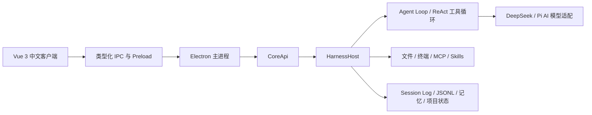

# 小金 Agent · XiaoJin Agent

中文桌面智能体工作台，面向个人开发者和技术工作者，支持普通对话、项目理解、任务规划、工具调用和执行轨迹查看。

小金 Agent 适合以下场景：

- 阅读和理解本地代码仓库
- 结合项目文件进行技术调研和资料整理
- 在授权后修改文件、运行命令并查看执行结果
- 将复杂任务拆分为计划，持续跟踪任务进度
- 通过记忆、Skills 和 MCP 扩展工作能力

## 导航

- [快速开始](#快速开始)
- [核心工作流](#核心工作流)
- [能力概览](#能力概览)
- [架构与技术栈](#架构与技术栈)
- [数据与安全](#数据与安全)
- [当前边界](#当前边界)
- [开发与文档](#开发与文档)
- [开源说明](#开源说明)

### 环境要求

- Node.js 22 或更高版本，建议使用 Node.js 24
- npm
- Windows 下使用终端工具时，可能需要对应的原生编译工具

### 从源码启动

```powershell
git clone https://github.com/jtjjyy/xiaojin-agent.git
cd xiaojin-agent
npm ci
npm --prefix desktop ci
npm --prefix desktop run dev
```

Windows 也可以在安装依赖后运行：

```powershell
.\start-dev.cmd
```

首次进入客户端后，在设置中配置模型 Provider、模型 ID 和你自己的 API Key，再创建普通会话或绑定项目目录。本仓库不提供 API Key，也不会默认调用真实模型。

> 源码发布阶段没有执行新增测试、Lint、独立类型检查、打包或真实模型请求验证。能够启动开发版不等于所有功能和安装流程已经通过正式验收。

## 核心工作流

### Chat：普通对话

适合日常问答、资料整理和一次性工具任务。Chat 使用用户档案、全局长期记忆和当前会话历史，不绑定具体代码仓库。

### Build：项目工作

适合代码和文档项目。Build 会话绑定本地项目目录，Agent 可以读取项目中的 `AGENTS.md` 或 `CLAUDE.md`，并在授权范围内使用文件、搜索和终端工具。

### Plan：先规划再执行

Plan 模式先进行只读探索，整理目标、影响范围、实现步骤和验证方式；用户审阅并批准后，再进入执行阶段。

```text
/plan
/plan 为当前项目设计一套迁移方案
/plan off
```

### Goal：持续推进任务

Goal 用于需要多轮推进的任务。Agent 空闲后可以继续围绕同一个目标工作，直到目标完成、遇到阻塞或用户暂停。

```text
/goal 让项目的全部测试通过
/goal
/goal pause
/goal resume
/goal clear
```

Goal 不会自动提高文件、终端或网络权限；每一轮仍然遵循当前会话的权限设置。

### 常用斜杠命令

| 命令 | 作用 |
| --- | --- |
| `/new` | 创建新的会话 |
| `/compact` | 压缩会话上下文，保留摘要 |
| `/model` | 选择模型 |
| `/reasoning` | 调整思考强度 |
| `/permissions <预设>` | 查看或切换权限预设 |
| `/plan` | 进入规划模式 |
| `/goal` | 查看或设置持续目标 |
| `/stop` | 停止当前任务 |
| `/continue` | 继续上一项工作 |

## 能力概览

### Agent 执行

- 流式模型输出
- 多轮 Agent 工具循环
- Plan 规划模式
- Goal 持续任务
- 子代理任务委派
- 会话日志、运行状态和恢复路径

### 项目与知识

- 绑定本地项目目录
- 读取项目约定文件
- 用户档案、全局长期记忆和项目私有记忆
- 会话历史和上下文压缩
- 图片、文本及受支持文档附件

### 工具与扩展

- 文件读取、写入和编辑
- 文件搜索与项目检索
- Shell / 终端任务
- Todo 和用户提问
- Skills
- Plugins
- MCP Server
- 可选浏览器和电脑操作能力

### 桌面工作台

- Vue 3 中文桌面界面
- 多会话侧栏
- 项目环境信息卡
- Git Review
- 只读文件查看
- 用户直控终端
- 应用内浏览器
- Agent 轨迹和请求详情

### 运行观测

轨迹页面按请求组织会话运行记录，支持查看：

- 请求状态
- 模型请求配置
- 工具调用数量
- Token 使用情况
- 请求耗时
- 工具结果和运行记录
- Prompt 差异

这些信息用于理解 Agent 如何完成任务，也方便定位模型调用、工具执行和会话状态问题。

## 权限预设

| 权限预设 | 行为 |
| --- | --- |
| `read-only` | 可以读取；写入需要逐次批准 |
| `workspace-write` | 默认模式，可写当前工作区和临时目录；越界写入需要批准 |
| `danger-full-access` | 不限制写入，不弹出常规审批 |

审批只对具体的一次工具调用有效。审批弹窗不是沙箱，不能把它当作操作系统级隔离机制。

## 架构与技术栈



| 层级 | 技术与职责 |
| --- | --- |
| 桌面容器 | Electron 42 系列、Electron Main、Preload、Electron Builder |
| 前端界面 | Vue 3、Vue Router、Vite、electron-vite、Tailwind CSS、Lucide、xterm |
| 应用接口 | TypeScript `CoreApi`，负责桌面端与 Agent Runtime 的边界 |
| Agent Runtime | `HarnessHost`、Agent Loop、工具注册表、Middleware、Plan、Goal、Session Log |
| 模型与协议 | Pi AI、OpenAI/Anthropic SDK、MCP SDK、ACP SDK、Zod |
| 本地存储 | 本地文件、JSON/JSONL、会话日志、记忆、项目状态和附件 |
| 质量与构建 | Vitest、Playwright、ESLint、TypeScript、electron-builder |

桌面端主链路为：

```text
Vue Renderer
  -> Preload / IPC
  -> Electron Main
  -> CoreApi
  -> HarnessHost
  -> Agent Loop
  -> Model Provider / Tools
```

Renderer 不直接持有内核权威状态；会话日志是运行事实源，运行事件由日志投影给界面。文件、终端、MCP、Skills 和记忆等能力通过内核服务统一接入。

详细架构说明见 [架构总览](docs/architecture/overview.md) 和 [Agent 执行链路](docs/architecture/agent-runtime.md)。

## 数据与安全

### 本地优先不等于完全离线

- 模型上下文会发送到用户配置的 Provider。
- MCP、联网命令和 Skills 可能连接外部服务。
- 外部文档、网页内容和工具输出都应视为不可信数据。
- 不要把提示词约束当作完整安全边界。

### 权限边界

- 默认限制 Agent 的写入范围。
- 危险写入和越界操作需要用户审批，审批绑定具体调用及参数。
- Windows 当前没有受限 Shell 沙箱后端。
- macOS Seatbelt 和 Linux bubblewrap 是上游平台机制，不代表所有读取和网络外发都被阻断。
- 不承诺任意代码修改都可以自动回滚；恢复前应先核对实际执行状态。

### 本地数据

会话、记忆、配置、附件、Skills 和日志保存在本机运行目录中。模型配置和个人运行数据不会提交到源码仓库，使用时应自行保护 API Key、会话记录和项目文件。

## 当前边界

- 当前仓库是源码发布，不是已验收的正式安装包。
- 小金 Agent 是本地单用户桌面应用，不提供多租户服务端部署。
- Agent Runtime、模型适配、工具、记忆和持久化主要复用上游实现。

## 开发与文档

根目录和 `desktop/` 使用各自的 lockfile，需要分别安装依赖。开发版启动命令：

```powershell
npm ci
npm --prefix desktop ci
npm --prefix desktop run dev
```

文档入口：

- [文档导航](docs/README.md)
- [架构概览](docs/architecture/overview.md)
- [Agent 执行链路](docs/architecture/agent-runtime.md)
- [工具、Skills 与 MCP](docs/user/tools-skills-mcp.md)
- [模型、记忆与附件](docs/user/models-memory-attachments.md)
- [权限与安全边界](docs/architecture/control-and-permissions.md)
- [发布记录](docs/publication.md)
